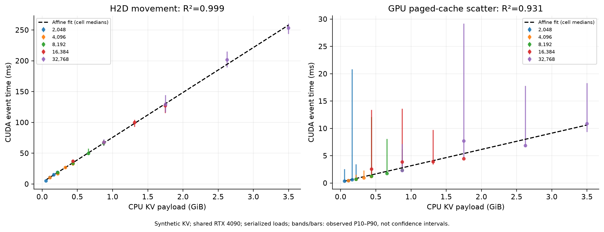

# CPU KV Cache 强制命中 Prefill 实验结果

实验日期：2026-11-04（Asia/Shanghai）；运行编号：`20261104T144901Z`。实验代码：[`d187ce5`](https://github.com/pe0-p1e/vllm-prefix-lab/commit/d187ce565c132d8cec759c8c01e54082dfb0a826)。

## 结果摘要

在本次共享 GPU 实验中，32K 输入近全命中时，TTFT 中位数由 1308.07 ms 降至 430.88 ms，观测加速比为 3.04×；16K 对应为 2.06×。2K、4K 近全命中分别只有 0.94×、0.88×，命中更多不保证延迟更低。[1]

2K–32K 的 25 个配置均完成 3 次预热与 10 次测量，共 250 次有效测量。64K/128K 超出模型原生上下文范围，未执行推理，全部明确记录为不支持。[1][2]

**这些是共享 GPU 上的描述性结果。其他用户负载、固定执行顺序与逐层同步会影响比较，不能据此宣称独占 GPU 的因果加速收益。** P99 每格仅由 10 个样本估计，稳定性有限。

## 图表与拟合

[查看完整图表与传输拟合](figures/README.md)：包含命中率—延迟曲线、观测加速比、H2D/scatter 载荷拟合及交叉验证。



## 如何读这些指标

| 指标 | 测量口径 |
|---|---|
| CPU 命中 | 外部 HOST 缓存命中；GPU APC 关闭 |
| CUDA H2D | 每层 CPU→GPU staging copy 的 CUDA Events 时间之和 |
| GPU 页块写入 | staging→真实 vLLM paged KV cache 的 index_copy CUDA Events 时间之和 |
| 总加载 | worker 墙钟时间，包括准备、传输、scatter、同步和主机开销 |
| Prefill 服务 | vLLM Prefill 阶段时间，包含 KV 加载等开销；不是纯 GPU compute |
| TTFT / 总延迟 | 客户端从发出请求至首个输出 / 请求结束的墙钟时间 |
| 加速比 | 相同长度的禁用缓存 TTFT 中位数 ÷ 当前配置 TTFT 中位数 |

下表时间单位均为 **ms**，除尾延迟表外均为中位数。每格 n=10。不同指标分别取中位数，不能要求各列中位数精确相加。

## 全部配置的延迟与加速比

来源：[1]。0% 为独立的 Cache Disabled 引擎；“近100%”仍需重算最后一个 16-token 块。

| 输入 token | 请求比例 | 实际比例 | 注入 token | 重算 token | H2D | 页块写入 | Prefill 服务 | TTFT | 总延迟 | 加速比 |
|---:|---:|---:|---:|---:|---:|---:|---:|---:|---:|---:|
| 2048 | 0% | 0.00000% | 0 | 2048 | 0.00 | 0.00 | 57.35 | 74.97 | 75.33 | 1.00× |
| 2048 | 25% | 25.00000% | 512 | 1536 | 5.23 | 0.38 | 46.95 | 56.51 | 56.70 | 1.33× |
| 2048 | 50% | 50.00000% | 1024 | 1024 | 10.72 | 0.46 | 56.31 | 65.21 | 65.35 | 1.15× |
| 2048 | 75% | 75.00000% | 1536 | 512 | 15.22 | 0.60 | 64.84 | 74.72 | 74.89 | 1.00× |
| 2048 | 近100% | 99.21875% | 2032 | 16 | 19.23 | 0.70 | 69.97 | 79.90 | 80.05 | 0.94× |
| 4096 | 0% | 0.00000% | 0 | 4096 | 0.00 | 0.00 | 70.80 | 96.21 | 96.92 | 1.00× |
| 4096 | 25% | 25.00000% | 1024 | 3072 | 10.53 | 0.46 | 65.46 | 79.35 | 79.55 | 1.21× |
| 4096 | 50% | 50.00000% | 2048 | 2048 | 16.90 | 0.70 | 64.23 | 77.35 | 77.63 | 1.24× |
| 4096 | 75% | 75.00000% | 3072 | 1024 | 27.07 | 0.96 | 73.99 | 86.65 | 86.86 | 1.11× |
| 4096 | 近100% | 99.60938% | 4080 | 16 | 32.95 | 1.22 | 94.47 | 109.84 | 110.05 | 0.88× |
| 8192 | 0% | 0.00000% | 0 | 8192 | 0.00 | 0.00 | 148.93 | 184.74 | 185.24 | 1.00× |
| 8192 | 25% | 25.00000% | 2048 | 6144 | 18.70 | 0.72 | 135.27 | 152.27 | 152.50 | 1.21× |
| 8192 | 50% | 50.00000% | 4096 | 4096 | 33.68 | 1.25 | 131.94 | 154.09 | 154.45 | 1.20× |
| 8192 | 75% | 75.00000% | 6144 | 2048 | 49.86 | 1.77 | 122.51 | 140.05 | 140.24 | 1.32× |
| 8192 | 近100% | 99.80469% | 8176 | 16 | 66.55 | 2.35 | 122.46 | 141.62 | 141.97 | 1.30× |
| 16384 | 0% | 0.00000% | 0 | 16384 | 0.00 | 0.00 | 391.52 | 464.58 | 465.33 | 1.00× |
| 16384 | 25% | 25.00000% | 4096 | 12288 | 36.92 | 2.58 | 441.01 | 473.70 | 473.89 | 0.98× |
| 16384 | 50% | 50.00000% | 8192 | 8192 | 67.55 | 3.86 | 360.44 | 393.51 | 393.97 | 1.18× |
| 16384 | 75% | 75.00000% | 12288 | 4096 | 99.99 | 3.90 | 298.97 | 327.07 | 327.24 | 1.42× |
| 16384 | 近100% | 99.90234% | 16368 | 16 | 127.11 | 4.45 | 199.13 | 225.27 | 225.53 | 2.06× |
| 32768 | 0% | 0.00000% | 0 | 32768 | 0.00 | 0.00 | 1222.10 | 1308.07 | 1308.92 | 1.00× |
| 32768 | 25% | 25.00000% | 8192 | 24576 | 67.78 | 2.30 | 1238.66 | 1291.98 | 1292.55 | 1.01× |
| 32768 | 50% | 50.00000% | 16384 | 16384 | 128.91 | 7.69 | 1162.29 | 1213.56 | 1213.74 | 1.08× |
| 32768 | 75% | 75.00000% | 24576 | 8192 | 201.57 | 6.87 | 788.30 | 838.38 | 838.53 | 1.56× |
| 32768 | 近100% | 99.95117% | 32752 | 16 | 253.50 | 10.86 | 371.38 | 430.88 | 431.33 | 3.04× |

## CPU KV 载荷、加载与带宽

来源：[1]。BF16 每 token KV 字节数为 `28 × 2 × 8 × 128 × 2 = 114688`。MiB 使用 2²⁰ 字节，GiB/s 使用 2³⁰ 字节/秒。禁用缓存的带宽不适用。

| 输入 token | 请求比例 | KV MiB | 总加载 ms | H2D GiB/s |
|---:|---:|---:|---:|---:|
| 2048 | 25% | 56.00 | 10.05 | 10.49 |
| 2048 | 50% | 112.00 | 15.77 | 10.21 |
| 2048 | 75% | 168.00 | 21.35 | 10.78 |
| 2048 | 近100% | 222.25 | 26.81 | 11.29 |
| 4096 | 25% | 112.00 | 16.27 | 10.39 |
| 4096 | 50% | 224.00 | 23.64 | 12.94 |
| 4096 | 75% | 336.00 | 34.32 | 12.12 |
| 4096 | 近100% | 446.25 | 40.74 | 13.23 |
| 8192 | 25% | 224.00 | 24.64 | 11.70 |
| 8192 | 50% | 448.00 | 43.05 | 12.99 |
| 8192 | 75% | 672.00 | 60.89 | 13.16 |
| 8192 | 近100% | 894.25 | 78.82 | 13.12 |
| 16384 | 25% | 448.00 | 51.21 | 11.85 |
| 16384 | 50% | 896.00 | 85.22 | 12.95 |
| 16384 | 75% | 1344.00 | 117.80 | 13.13 |
| 16384 | 近100% | 1790.25 | 140.22 | 13.76 |
| 32768 | 25% | 896.00 | 81.06 | 12.91 |
| 32768 | 50% | 1792.00 | 154.91 | 13.58 |
| 32768 | 75% | 2688.00 | 233.03 | 13.02 |
| 32768 | 近100% | 3582.25 | 293.37 | 13.80 |

## TTFT 的 P50、P95、P99

来源：[1]。P95/P99 使用线性插值；n=10，尾部估计不稳定。其他时间指标的分位数、标准差与范围见 [summary.csv](summary.csv)。

| 输入 token | 请求比例 | n | P50 ms | P95 ms | P99 ms |
|---:|---:|---:|---:|---:|---:|
| 2048 | 0% | 10 | 74.97 | 112.39 | 126.16 |
| 2048 | 25% | 10 | 56.51 | 77.67 | 84.52 |
| 2048 | 50% | 10 | 65.21 | 73.39 | 74.31 |
| 2048 | 75% | 10 | 74.72 | 149.08 | 150.29 |
| 2048 | 近100% | 10 | 79.90 | 115.54 | 131.67 |
| 4096 | 0% | 10 | 96.21 | 209.51 | 231.20 |
| 4096 | 25% | 10 | 79.35 | 84.62 | 84.82 |
| 4096 | 50% | 10 | 77.35 | 100.03 | 104.76 |
| 4096 | 75% | 10 | 86.65 | 125.24 | 142.84 |
| 4096 | 近100% | 10 | 109.84 | 114.20 | 114.46 |
| 8192 | 0% | 10 | 184.74 | 217.42 | 220.32 |
| 8192 | 25% | 10 | 152.27 | 159.07 | 159.36 |
| 8192 | 50% | 10 | 154.09 | 251.43 | 281.89 |
| 8192 | 75% | 10 | 140.05 | 256.70 | 273.02 |
| 8192 | 近100% | 10 | 141.62 | 179.09 | 190.66 |
| 16384 | 0% | 10 | 464.58 | 588.99 | 626.53 |
| 16384 | 25% | 10 | 473.70 | 517.32 | 518.17 |
| 16384 | 50% | 10 | 393.51 | 482.26 | 495.80 |
| 16384 | 75% | 10 | 327.07 | 356.37 | 360.55 |
| 16384 | 近100% | 10 | 225.27 | 239.90 | 242.79 |
| 32768 | 0% | 10 | 1308.07 | 1889.36 | 1898.82 |
| 32768 | 25% | 10 | 1291.98 | 1805.80 | 1822.71 |
| 32768 | 50% | 10 | 1213.56 | 1478.81 | 1531.17 |
| 32768 | 75% | 10 | 838.38 | 1071.91 | 1099.35 |
| 32768 | 近100% | 10 | 430.88 | 475.64 | 477.20 |

## 验证结果与未执行配置

来源：[2][3]。

- 所有测量请求的实际注入 token 加实际重算 token 等于输入长度；host 命中精确匹配配置。
- 260 次 CPU KV 加载（含预热）的载荷字节数检查全部通过；20 个 CPU 配置合计 560 层次完整 GPU 回读通过。
- 每个配置内 CPU 缓冲地址保持一致；每次请求仍执行新的 H2D 和页块写入。
- 测量请求无失败、无抢占。日志中的退出期 EngineDeadError 发生在最后一次请求完成后的主动 SIGTERM 清理阶段。
- 原始崩溃由错误的 KV 布局断言导致：本机 FlashAttention 使用 `[blocks, KV_heads, block_size, 2×head_dim]`，而原代码要求第二维等于 2。修复后使用注册的真实缓存并验证映射。
- 普通单元测试 7 项通过；实际 CUDA 测试通过，覆盖非连续块、未选块、重复写入、CPU 缓冲复用及越界拒绝。普通测试发现会跳过 CUDA 专项，专项另行显式运行。

| 输入 token | 请求命中比例 | 状态 | 原因 |
|---:|---|---|---|
| 65536 | 0%、25%、50%、75%、近100% | 未执行推理 | 原生 max_position_embeddings=40960，未配置 RoPE scaling |
| 131072 | 0%、25%、50%、75%、近100% | 未执行推理 | 同上；第二块 GPU 不会扩展原生位置范围 |

最大已验证输入长度为 **32768 token**。没有使用不受支持的上下文覆盖或更短输入代替。

## 实验设置与限制

- 主机 `4090-02`，GPU 1：RTX 4090 24 GB；启动前已有约 16952 MiB 被其他任务占用。GPU memory utilization 配置为 0.25。
- Qwen3-0.6B，本地权重；vLLM 0.32.0；BF16 KV，28 层、8 KV heads、head dimension 128；PCIe 采样为 Gen4 x16。
- 输入为精确长度的有效 token ID Python 列表。Synthetic KV 已初始化，但不要求与输入有语义对应；这不验证生成内容正确性。
- 单请求，max-num-seqs=1；temperature=0；输出 1 token；APC 关闭；eager；chunked Prefill 8192；两种模式固定最大上下文 32769。
- 每格先预热 3 次，再测量 10 次；独立基线服务与 CPU 注入服务。CPU pinned buffer 在每格内复用，初始化不计入测量重复。
- 配置按命中比例、长度顺序执行，未随机化；共享 GPU 负载随时间变化可能混淆配置比较。
- 每层同步是本次测量方法的一部分，会限制传输与计算重叠；H2D 和 scatter 都不是完整加载时间。
- 未取得可靠的纯模型执行或 Attention-only kernel 时间；单 token 输出也不能衡量持续 decode 吞吐。硬件利用率是整卡值，包含其他用户。

后续应在独占 GPU 上随机化配置顺序复测，对比逐层同步与低同步加载；若测 64K/128K，应选择原生支持相应上下文的模型。

## 数据来源与复核

1. [table.csv](table.csv)：原始运行的逐配置中位结果、P95/P99、命中 token、带宽与观测加速比；[summary.csv](summary.csv) 提供各延迟指标的详细描述统计。
2. [configuration.json](configuration.json)：原始运行配置快照。
3. [validation-summary.json](validation-summary.json)：原始验证结果的轻量摘要，包含 CPU 缓冲持久性与不支持配置。

服务器完整原始运行目录：`/state/partition/fyzhou/results/cpu-kv-live/20261104T144901Z/`，包括 matrix.csv、逐层加载 JSON、hardware.csv 和完整服务日志。本次发布的是可直接阅读的结果与轻量汇总，不包含大体积原始日志。

报告中 25 个配置的 n 与 TTFT 中位数已从 matrix.csv 独立重新分组核对。统计生成与验证逻辑见仓库 `scripts/summarize_cpu_kv_live.py`、`scripts/validate_cpu_kv_results.py`。

原始源文件 SHA256（用于对应服务器证据）：

```text
ac8745bbac3794bb4f64ad3c80fd3bc7caebc2827e1b1c92b502568e6e3be4ea  matrix.csv
9693b8fa7a20f35d08251a56875230ebca5cb76d37100c987ca54a5e4413f2fb  table.csv
484d5739db2a5334f0d6710ccd67b48c862ffc5900f625ecba3ff7dd2cf7b9ca  summary.csv
7fd4b0f74ac8c5aa5d1e9b756f813cdb454f0ea72965341a7ee23722b5c43b8f  configuration.json
e4820ede9eec2dbbd247c4bc0917ee41348a01ced8ffbbd70571ec98ca836a2e  validation.json
```
