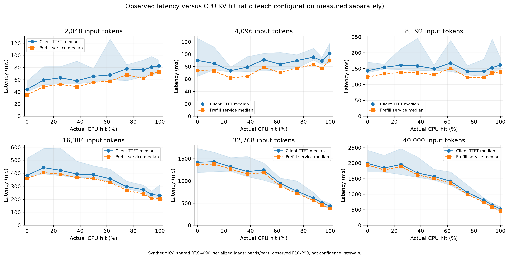
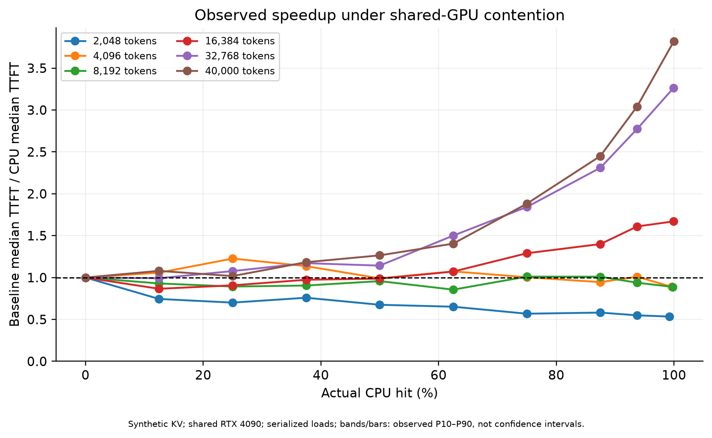
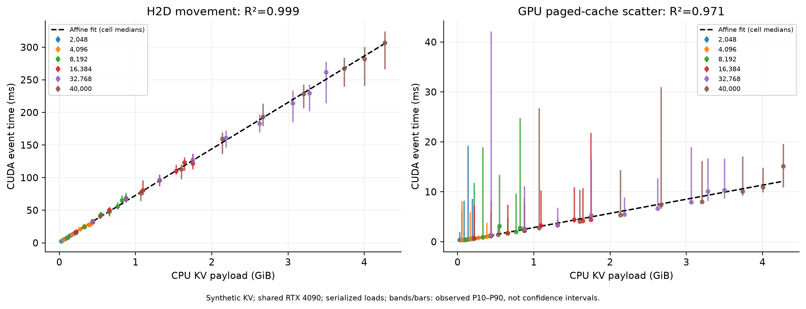
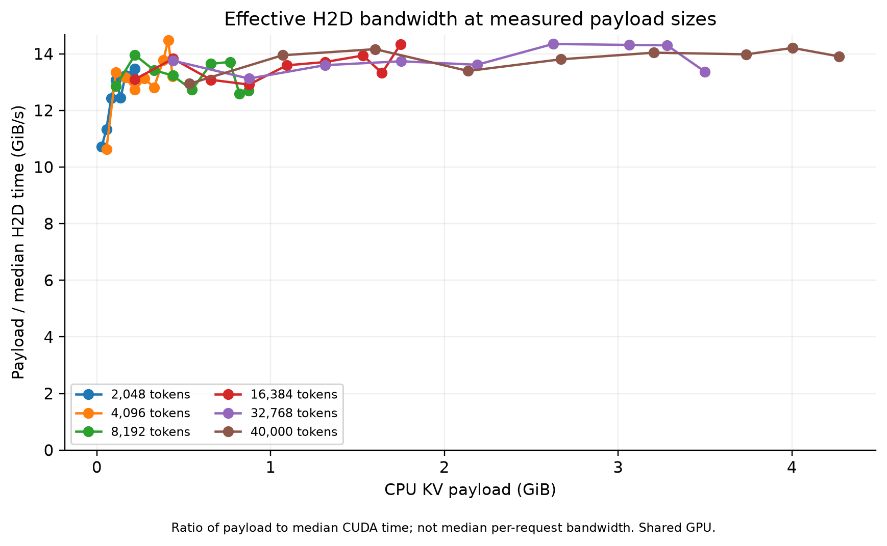

# CPU KV Cache 细粒度 Prefill 实验结果

运行编号：`20261104T164508Z`；模型 Qwen3-0.6B；实验日期以运行配置和硬件采样为准。

## 结果摘要

本轮完成 60 个配置，每格 3 次预热、20 次测量，共 1200 次有效测量。最大验证输入为 40,000 token。[1][2]

在 40,000 token 输入下，近全命中 TTFT 中位数为 521.30 ms，独立禁用缓存基线为 1990.31 ms，观测加速比 3.82×。实际注入 39,984 token，重算 16 token。[1]

**共享 GPU 负载、同步开销和基线与 CPU 模式分开执行会影响比较；这些是描述性测量，不代表独占 GPU 的因果性能收益。** 本轮随机化了各模式内部配置顺序，但没有消除跨模式时间漂移。

## 曲线与拟合

见 [完整图表、拟合系数和交叉验证](figures/README.md)。图中阴影/误差棒为观测 P10–P90，不是置信区间。









## 全部配置结果

来源：[1]。时间为 ms，中位数；每格 n 相同。0% 为独立 Cache Disabled 引擎。近100% 实际仍重算最后一块。各指标分别取中位数，不应强求列间加法相等。

| 输入 token | 请求比例 | 实际比例 | 注入 token | 重算 token | H2D ms | 页块写入 ms | Prefill 服务 ms | TTFT ms | 总延迟 ms | 加速比 |
|---:|---:|---:|---:|---:|---:|---:|---:|---:|---:|---:|
| 2048 | 0% | 0.00000% | 0 | 2048 | 0.00 | 0.00 | 35.43 | 44.26 | 44.41 | 1.00× |
| 2048 | 12.5% | 12.50000% | 256 | 1792 | 2.55 | 0.39 | 48.55 | 59.45 | 59.60 | 0.74× |
| 2048 | 25% | 25.00000% | 512 | 1536 | 4.82 | 0.35 | 52.43 | 63.16 | 63.37 | 0.70× |
| 2048 | 37.5% | 37.50000% | 768 | 1280 | 6.60 | 0.38 | 48.56 | 58.31 | 58.49 | 0.76× |
| 2048 | 50% | 50.00000% | 1024 | 1024 | 8.36 | 0.44 | 55.74 | 65.58 | 65.77 | 0.67× |
| 2048 | 62.5% | 62.50000% | 1280 | 768 | 10.98 | 0.50 | 57.63 | 67.91 | 68.09 | 0.65× |
| 2048 | 75% | 75.00000% | 1536 | 512 | 12.40 | 0.56 | 67.96 | 77.88 | 78.01 | 0.57× |
| 2048 | 87.5% | 87.50000% | 1792 | 256 | 14.48 | 0.62 | 62.30 | 76.10 | 76.25 | 0.58× |
| 2048 | 93.75% | 93.75000% | 1920 | 128 | 15.49 | 0.66 | 69.54 | 80.62 | 81.23 | 0.55× |
| 2048 | 近100% | 99.21875% | 2032 | 16 | 16.11 | 0.68 | 73.03 | 82.84 | 82.95 | 0.53× |
| 4096 | 0% | 0.00000% | 0 | 4096 | 0.00 | 0.00 | 73.56 | 90.02 | 90.29 | 1.00× |
| 4096 | 12.5% | 12.50000% | 512 | 3584 | 5.14 | 0.35 | 72.75 | 85.08 | 85.25 | 1.06× |
| 4096 | 25% | 25.00000% | 1024 | 3072 | 8.20 | 0.43 | 61.90 | 73.39 | 73.50 | 1.23× |
| 4096 | 37.5% | 37.50000% | 1536 | 2560 | 12.47 | 0.55 | 64.19 | 79.25 | 79.49 | 1.14× |
| 4096 | 50% | 50.00000% | 2048 | 2048 | 17.19 | 0.67 | 78.61 | 90.89 | 91.08 | 0.99× |
| 4096 | 62.5% | 62.50000% | 2560 | 1536 | 20.82 | 0.83 | 70.39 | 83.87 | 84.02 | 1.07× |
| 4096 | 75% | 75.00000% | 3072 | 1024 | 25.62 | 0.93 | 77.13 | 89.68 | 89.85 | 1.00× |
| 4096 | 87.5% | 87.50000% | 3584 | 512 | 27.78 | 1.07 | 83.43 | 95.25 | 95.40 | 0.95× |
| 4096 | 93.75% | 93.75000% | 3840 | 256 | 28.32 | 1.16 | 77.20 | 89.12 | 89.27 | 1.01× |
| 4096 | 近100% | 99.60938% | 4080 | 16 | 33.01 | 1.20 | 89.72 | 101.21 | 101.40 | 0.89× |
| 8192 | 0% | 0.00000% | 0 | 8192 | 0.00 | 0.00 | 123.17 | 143.44 | 143.76 | 1.00× |
| 8192 | 12.5% | 12.50000% | 1024 | 7168 | 8.50 | 0.44 | 134.34 | 154.30 | 154.70 | 0.93× |
| 8192 | 25% | 25.00000% | 2048 | 6144 | 15.67 | 0.71 | 137.56 | 160.71 | 160.99 | 0.89× |
| 8192 | 37.5% | 37.50000% | 3072 | 5120 | 24.45 | 0.95 | 137.14 | 158.57 | 158.88 | 0.90× |
| 8192 | 50% | 50.00000% | 4096 | 4096 | 33.07 | 1.20 | 131.02 | 149.82 | 149.98 | 0.96× |
| 8192 | 62.5% | 62.50000% | 5120 | 3072 | 42.98 | 3.16 | 150.62 | 167.69 | 167.84 | 0.86× |
| 8192 | 75% | 75.00000% | 6144 | 2048 | 48.10 | 1.73 | 123.03 | 141.86 | 142.03 | 1.01× |
| 8192 | 87.5% | 87.50000% | 7168 | 1024 | 55.83 | 1.99 | 123.06 | 142.01 | 142.19 | 1.01× |
| 8192 | 93.75% | 93.75000% | 7680 | 512 | 65.18 | 2.77 | 136.56 | 152.93 | 153.10 | 0.94× |
| 8192 | 近100% | 99.80469% | 8176 | 16 | 68.80 | 2.24 | 140.16 | 161.47 | 161.65 | 0.89× |
| 16384 | 0% | 0.00000% | 0 | 16384 | 0.00 | 0.00 | 361.06 | 383.35 | 383.56 | 1.00× |
| 16384 | 12.5% | 12.50000% | 2048 | 14336 | 16.70 | 0.70 | 405.13 | 442.75 | 443.00 | 0.87× |
| 16384 | 25% | 25.00000% | 4096 | 12288 | 31.64 | 1.21 | 392.78 | 422.68 | 422.84 | 0.91× |
| 16384 | 37.5% | 37.50000% | 6144 | 10240 | 50.17 | 1.73 | 366.44 | 393.73 | 393.89 | 0.97× |
| 16384 | 50% | 50.00000% | 8192 | 8192 | 67.77 | 2.28 | 358.52 | 388.41 | 388.60 | 0.99× |
| 16384 | 62.5% | 62.50000% | 10240 | 6144 | 80.47 | 3.29 | 329.37 | 357.83 | 358.16 | 1.07× |
| 16384 | 75% | 75.00000% | 12288 | 4096 | 95.75 | 3.35 | 269.05 | 297.18 | 297.40 | 1.29× |
| 16384 | 87.5% | 87.50000% | 14336 | 2048 | 109.86 | 4.45 | 240.20 | 273.85 | 274.00 | 1.40× |
| 16384 | 93.75% | 93.75000% | 15360 | 1024 | 123.18 | 4.20 | 208.44 | 238.10 | 238.25 | 1.61× |
| 16384 | 近100% | 99.90234% | 16368 | 16 | 121.90 | 4.45 | 204.14 | 229.55 | 229.76 | 1.67× |
| 32768 | 0% | 0.00000% | 0 | 32768 | 0.00 | 0.00 | 1371.56 | 1421.46 | 1421.65 | 1.00× |
| 32768 | 12.5% | 12.50000% | 4096 | 28672 | 31.80 | 1.39 | 1381.14 | 1432.95 | 1433.25 | 0.99× |
| 32768 | 25% | 25.00000% | 8192 | 24576 | 66.68 | 2.63 | 1267.94 | 1319.71 | 1319.89 | 1.08× |
| 32768 | 37.5% | 37.50000% | 12288 | 20480 | 96.53 | 3.36 | 1156.49 | 1213.25 | 1213.46 | 1.17× |
| 32768 | 50% | 50.00000% | 16384 | 16384 | 127.42 | 5.28 | 1187.45 | 1244.25 | 1244.55 | 1.14× |
| 32768 | 62.5% | 62.50000% | 20480 | 12288 | 160.71 | 5.51 | 885.55 | 947.08 | 947.36 | 1.50× |
| 32768 | 75% | 75.00000% | 24576 | 8192 | 182.98 | 6.66 | 719.75 | 771.66 | 771.96 | 1.84× |
| 32768 | 87.5% | 87.50000% | 28672 | 4096 | 213.98 | 7.91 | 557.78 | 615.14 | 615.48 | 2.31× |
| 32768 | 93.75% | 93.75000% | 30720 | 2048 | 229.48 | 10.08 | 458.76 | 512.23 | 512.51 | 2.78× |
| 32768 | 近100% | 99.95117% | 32752 | 16 | 261.64 | 10.36 | 384.28 | 435.30 | 435.47 | 3.27× |
| 40000 | 0% | 0.00000% | 0 | 40000 | 0.00 | 0.00 | 1936.85 | 1990.31 | 1990.48 | 1.00× |
| 40000 | 12.5% | 12.48000% | 4992 | 35008 | 41.20 | 1.45 | 1779.50 | 1843.55 | 1843.73 | 1.08× |
| 40000 | 25% | 25.00000% | 10000 | 30000 | 76.58 | 2.76 | 1891.02 | 1956.11 | 1956.40 | 1.02× |
| 40000 | 37.5% | 37.48000% | 14992 | 25008 | 113.06 | 4.09 | 1625.71 | 1682.38 | 1682.56 | 1.18× |
| 40000 | 50% | 50.00000% | 20000 | 20000 | 159.51 | 5.38 | 1501.37 | 1573.59 | 1573.92 | 1.26× |
| 40000 | 62.5% | 62.48000% | 24992 | 15008 | 193.38 | 7.39 | 1357.58 | 1416.95 | 1417.11 | 1.40× |
| 40000 | 75% | 75.00000% | 30000 | 10000 | 228.24 | 8.01 | 998.13 | 1057.94 | 1058.22 | 1.88× |
| 40000 | 87.5% | 87.48000% | 34992 | 5008 | 267.35 | 10.11 | 745.19 | 812.38 | 812.65 | 2.45× |
| 40000 | 93.75% | 93.72000% | 37488 | 2512 | 281.86 | 10.98 | 590.93 | 654.63 | 654.80 | 3.04× |
| 40000 | 近100% | 99.96000% | 39984 | 16 | 307.09 | 15.11 | 458.67 | 521.30 | 521.55 | 3.82× |

## CPU KV 载荷与加载

来源：[1]。MiB=2²⁰ 字节；GiB/s=2³⁰ 字节/秒。BF16 每 token KV 为 114688 字节。

| 输入 token | 请求比例 | KV MiB | 总加载 ms | H2D GiB/s |
|---:|---:|---:|---:|---:|
| 2048 | 12.5% | 28.00 | 8.16 | 10.71 |
| 2048 | 25% | 56.00 | 11.17 | 11.34 |
| 2048 | 37.5% | 84.00 | 11.84 | 12.43 |
| 2048 | 50% | 112.00 | 13.84 | 13.08 |
| 2048 | 62.5% | 140.00 | 17.14 | 12.45 |
| 2048 | 75% | 168.00 | 19.31 | 13.23 |
| 2048 | 87.5% | 196.00 | 21.30 | 13.21 |
| 2048 | 93.75% | 210.00 | 22.26 | 13.24 |
| 2048 | 近100% | 222.25 | 23.79 | 13.47 |
| 4096 | 12.5% | 56.00 | 11.03 | 10.64 |
| 4096 | 25% | 112.00 | 13.69 | 13.34 |
| 4096 | 37.5% | 168.00 | 18.37 | 13.16 |
| 4096 | 50% | 224.00 | 23.65 | 12.72 |
| 4096 | 62.5% | 280.00 | 26.97 | 13.13 |
| 4096 | 75% | 336.00 | 33.18 | 12.81 |
| 4096 | 87.5% | 392.00 | 36.42 | 13.78 |
| 4096 | 93.75% | 420.00 | 35.41 | 14.48 |
| 4096 | 近100% | 446.25 | 41.52 | 13.20 |
| 8192 | 12.5% | 112.00 | 14.58 | 12.86 |
| 8192 | 25% | 224.00 | 22.93 | 13.96 |
| 8192 | 37.5% | 336.00 | 33.08 | 13.42 |
| 8192 | 50% | 448.00 | 40.50 | 13.23 |
| 8192 | 62.5% | 560.00 | 58.12 | 12.73 |
| 8192 | 75% | 672.00 | 57.88 | 13.64 |
| 8192 | 87.5% | 784.00 | 66.51 | 13.71 |
| 8192 | 93.75% | 840.00 | 81.40 | 12.59 |
| 8192 | 近100% | 894.25 | 80.21 | 12.69 |
| 16384 | 12.5% | 224.00 | 24.77 | 13.10 |
| 16384 | 25% | 448.00 | 39.16 | 13.83 |
| 16384 | 37.5% | 672.00 | 59.94 | 13.08 |
| 16384 | 50% | 896.00 | 80.73 | 12.91 |
| 16384 | 62.5% | 1120.00 | 96.74 | 13.59 |
| 16384 | 75% | 1344.00 | 109.64 | 13.71 |
| 16384 | 87.5% | 1568.00 | 125.40 | 13.94 |
| 16384 | 93.75% | 1680.00 | 137.73 | 13.32 |
| 16384 | 近100% | 1790.25 | 143.53 | 14.34 |
| 32768 | 12.5% | 448.00 | 41.63 | 13.76 |
| 32768 | 25% | 896.00 | 81.20 | 13.12 |
| 32768 | 37.5% | 1344.00 | 111.76 | 13.60 |
| 32768 | 50% | 1792.00 | 148.61 | 13.73 |
| 32768 | 62.5% | 2240.00 | 182.68 | 13.61 |
| 32768 | 75% | 2688.00 | 210.22 | 14.35 |
| 32768 | 87.5% | 3136.00 | 244.83 | 14.31 |
| 32768 | 93.75% | 3360.00 | 262.46 | 14.30 |
| 32768 | 近100% | 3582.25 | 297.37 | 13.37 |
| 40000 | 12.5% | 546.00 | 51.15 | 12.94 |
| 40000 | 25% | 1093.75 | 90.54 | 13.95 |
| 40000 | 37.5% | 1639.75 | 130.35 | 14.16 |
| 40000 | 50% | 2187.50 | 183.37 | 13.39 |
| 40000 | 62.5% | 2733.50 | 223.71 | 13.80 |
| 40000 | 75% | 3281.25 | 252.98 | 14.04 |
| 40000 | 87.5% | 3827.25 | 299.39 | 13.98 |
| 40000 | 93.75% | 4100.25 | 320.46 | 14.21 |
| 40000 | 近100% | 4373.25 | 358.00 | 13.91 |

## TTFT 尾延迟

来源：[1]。小样本 P99 不稳定，不能作为服务等级承诺。

| 输入 token | 请求比例 | n | P50 ms | P95 ms | P99 ms |
|---:|---:|---:|---:|---:|---:|
| 2048 | 0% | 20 | 44.26 | 61.52 | 91.25 |
| 2048 | 12.5% | 20 | 59.45 | 84.89 | 89.15 |
| 2048 | 25% | 20 | 63.16 | 87.13 | 91.07 |
| 2048 | 37.5% | 20 | 58.31 | 95.19 | 143.37 |
| 2048 | 50% | 20 | 65.58 | 81.65 | 95.75 |
| 2048 | 62.5% | 20 | 67.91 | 143.51 | 177.14 |
| 2048 | 75% | 20 | 77.88 | 86.09 | 88.18 |
| 2048 | 87.5% | 20 | 76.10 | 112.53 | 126.60 |
| 2048 | 93.75% | 20 | 80.62 | 100.08 | 100.81 |
| 2048 | 近100% | 20 | 82.84 | 93.53 | 96.12 |
| 4096 | 0% | 20 | 90.02 | 132.27 | 155.75 |
| 4096 | 12.5% | 20 | 85.08 | 119.45 | 129.16 |
| 4096 | 25% | 20 | 73.39 | 79.89 | 82.75 |
| 4096 | 37.5% | 20 | 79.25 | 140.21 | 173.52 |
| 4096 | 50% | 20 | 90.89 | 103.72 | 111.31 |
| 4096 | 62.5% | 20 | 83.87 | 105.56 | 116.61 |
| 4096 | 75% | 20 | 89.68 | 102.01 | 109.56 |
| 4096 | 87.5% | 20 | 95.25 | 126.67 | 140.41 |
| 4096 | 93.75% | 20 | 89.12 | 96.68 | 104.65 |
| 4096 | 近100% | 20 | 101.21 | 121.21 | 138.44 |
| 8192 | 0% | 20 | 143.44 | 191.25 | 191.64 |
| 8192 | 12.5% | 20 | 154.30 | 167.92 | 168.44 |
| 8192 | 25% | 20 | 160.71 | 275.24 | 316.43 |
| 8192 | 37.5% | 20 | 158.57 | 263.18 | 312.34 |
| 8192 | 50% | 20 | 149.82 | 162.82 | 166.33 |
| 8192 | 62.5% | 20 | 167.69 | 245.21 | 274.25 |
| 8192 | 75% | 20 | 141.86 | 174.54 | 211.43 |
| 8192 | 87.5% | 20 | 142.01 | 222.33 | 322.39 |
| 8192 | 93.75% | 20 | 152.93 | 267.87 | 289.00 |
| 8192 | 近100% | 20 | 161.47 | 201.13 | 247.28 |
| 16384 | 0% | 20 | 383.35 | 516.43 | 526.32 |
| 16384 | 12.5% | 20 | 442.75 | 653.95 | 813.97 |
| 16384 | 25% | 20 | 422.68 | 622.72 | 683.57 |
| 16384 | 37.5% | 20 | 393.73 | 499.07 | 509.07 |
| 16384 | 50% | 20 | 388.41 | 476.29 | 513.78 |
| 16384 | 62.5% | 20 | 357.83 | 469.11 | 504.90 |
| 16384 | 75% | 20 | 297.18 | 341.76 | 359.37 |
| 16384 | 87.5% | 20 | 273.85 | 319.03 | 340.48 |
| 16384 | 93.75% | 20 | 238.10 | 278.81 | 280.28 |
| 16384 | 近100% | 20 | 229.55 | 319.73 | 353.51 |
| 32768 | 0% | 20 | 1421.46 | 1845.46 | 2029.91 |
| 32768 | 12.5% | 20 | 1432.95 | 2112.14 | 2248.41 |
| 32768 | 25% | 20 | 1319.71 | 1595.99 | 1631.72 |
| 32768 | 37.5% | 20 | 1213.25 | 1632.27 | 1733.01 |
| 32768 | 50% | 20 | 1244.25 | 1466.77 | 1581.27 |
| 32768 | 62.5% | 20 | 947.08 | 1073.12 | 1083.54 |
| 32768 | 75% | 20 | 771.66 | 1100.67 | 1289.74 |
| 32768 | 87.5% | 20 | 615.14 | 808.76 | 934.00 |
| 32768 | 93.75% | 20 | 512.23 | 619.83 | 622.67 |
| 32768 | 近100% | 20 | 435.30 | 499.04 | 507.58 |
| 40000 | 0% | 20 | 1990.31 | 2457.35 | 2569.94 |
| 40000 | 12.5% | 20 | 1843.55 | 2336.77 | 2502.57 |
| 40000 | 25% | 20 | 1956.11 | 2527.46 | 2772.18 |
| 40000 | 37.5% | 20 | 1682.38 | 2296.75 | 2454.07 |
| 40000 | 50% | 20 | 1573.59 | 2101.86 | 2130.87 |
| 40000 | 62.5% | 20 | 1416.95 | 1737.80 | 1893.18 |
| 40000 | 75% | 20 | 1057.94 | 1362.38 | 1784.01 |
| 40000 | 87.5% | 20 | 812.38 | 890.18 | 908.01 |
| 40000 | 93.75% | 20 | 654.63 | 776.12 | 812.56 |
| 40000 | 近100% | 20 | 521.30 | 609.48 | 639.67 |

## 验证与实验口径

来源：[2][3]。1242 次加载字节审计通过，1484 层次完整回读通过。新准备的缓冲逐层完整回读；连续相同载荷可复用已验证的缓冲。每格 CPU 缓冲保持复用，各请求重新执行传输和写入；实际注入 token 加重算 token 等于输入长度。

- 输入是精确长度的 token ID 列表；synthetic KV 已初始化，但不要求语义匹配，不验证输出正确性。
- BF16、28 层、8 KV heads、head dimension 128；单 GPU、单请求；温度 0，输出 1 token；APC 关闭。
- eager、8192-token chunked Prefill；pinned CPU buffer；每层同步；两模式使用相同最大上下文与 GPU memory utilization。具体值见配置文件。
- H2D、GPU 页块写入分别使用 CUDA Events；总加载是 worker 墙钟时间；Prefill 是包含加载开销的 vLLM 服务阶段时间；TTFT/完成延迟是客户端墙钟时间。
- 没有可靠的纯模型 GPU compute、Attention-only 时间；不能把 Prefill 服务时间减去传输就称作纯计算。单输出 token 也不能评估持续 decode 吞吐。
- `cell_order.json` 记录真实顺序；固定 seed 打乱各模式内部配置，基线模式整体先执行。共享负载及跨模式漂移仍存在。
- 模型 max_position_embeddings=40960，rope_scaling=null。本轮按用户确认仅在原生范围内执行；64K/128K 未执行推理并继续记录为不支持。原生上限不是权限限制，也不等于安全覆盖后的模型有效性保证。

## 下一步

独占 GPU 后随机交替基线与注入模式，检验本轮曲线是否复现；再比较逐层同步和低同步加载，量化 instrumentation 对延迟的影响。需要 64K/128K 时，应使用原生支持相应上下文的模型，另建实验口径。

## 数据来源与复核

1. [table.csv](table.csv) 和 [summary.csv](summary.csv)：逐配置中位数、分位数、标准差及范围。
2. [configuration.json](configuration.json) 与 [cell_order.json](cell_order.json)：运行设置与执行顺序。
3. [validation-summary.json](validation-summary.json)：完整审计的轻量摘要。

服务器完整原始记录目录：`/state/partition/fyzhou/results/cpu-kv-live/20261104T164508Z`。CSV 汇总与图片公开于本页；大体积逐层 JSON、逐请求矩阵、硬件采样与日志保留在服务器。

本页配置数量均从实际源数据计算，不以预定计划代替成功结果。全部有效配置的样本数和 TTFT 中位数已从 matrix.csv 独立重新分组复核。

原始源文件 SHA256：

```text
5ba2af37636b47d61652005c4a635a48e24abf800c300860a58f9840ea5802f6  matrix.csv
681f806df0703554a8a9f1abd8bd7b8b5feaafeb5c47ad6bb94a5356aab98dac  table.csv
a0f2f49fdc2d456be31a72fc0ed143396d9a0450bae4e9b3451c00b74f128032  summary.csv
1c51fcbb4ea0f03ef213a5a17f5b2a8af2004988477ea486e4bef6c7a39f7cfc  configuration.json
b891c6a972e22fe742e11a6f702c698cc86f31e1f8517effdffa036195823bd3  validation.json
```
