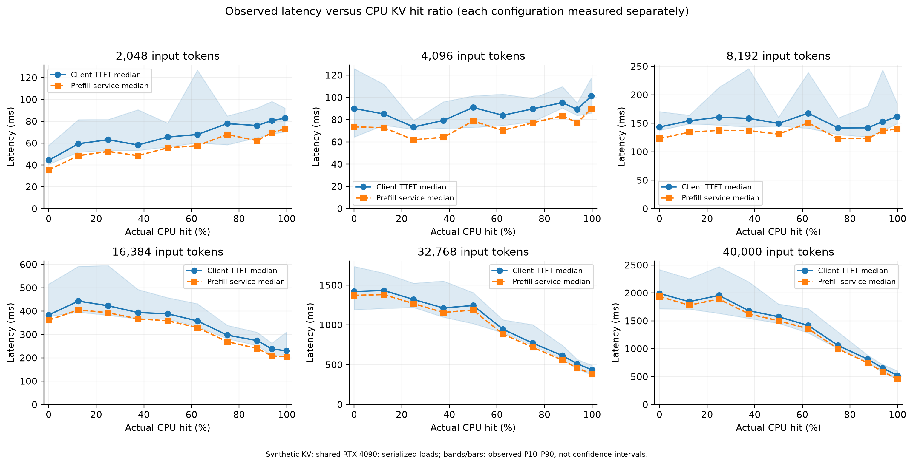
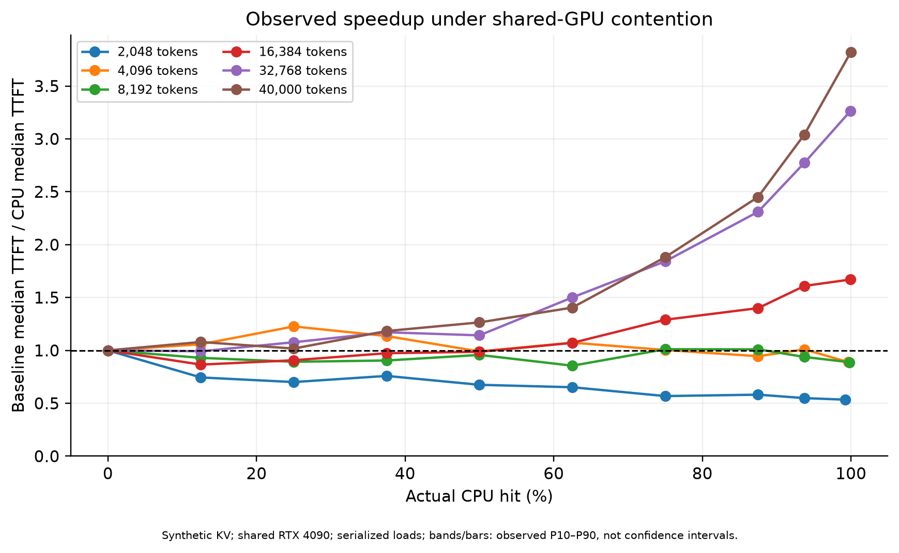
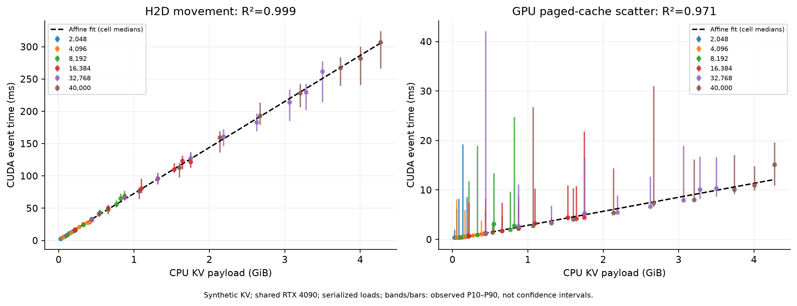
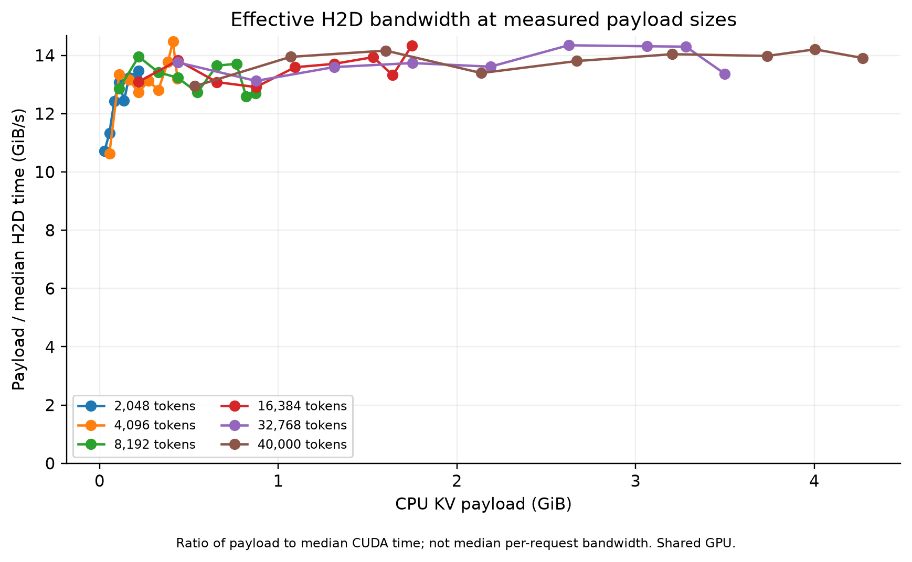
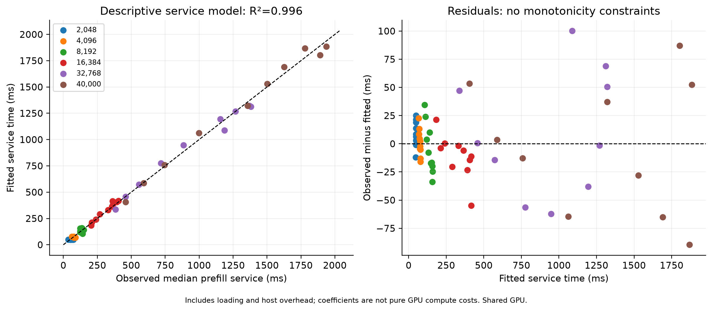

# 作图与传输拟合

本页使用同一运行的有效测量数据。连线仅连接实际配置，不是 Prefill 计算模型。阴影和误差棒为各配置观测 P10–P90，不是置信区间。

## 拟合口径与结果

传输阶段拟合 `时间(ms) = 截距 + 斜率 × KV载荷(GiB)`。对每个配置先取中位数，再做等权最小二乘。留一载荷交叉验证会同时移除相同字节数的全部配置，避免相同载荷泄漏。

| 阶段 | 截距 ms | 斜率 ms/GiB | R² | 残差 RMSE ms | 留一载荷 RMSE ms |
|---|---:|---:|---:|---:|---:|
| h2d_cuda_ms | 1.684 | 71.210 | 0.9988 | 2.897 | 3.092 |
| scatter_cuda_ms | 0.017 | 2.832 | 0.9705 | 0.577 | 0.645 |

## Prefill 服务时间的描述性拟合

响应变量是各配置的 Prefill 服务时间中位数。特征为剩余 token 数 M/1024、causal Attention pairs/1e8、KV载荷 GiB、是否加载 CPU KV，以及截距。pairs=M×(2H+M+1)/2 只是全因果 Attention 工作量代理，不能当作实测 kernel FLOPs。

R²=0.9959；训练残差 RMSE=34.872 ms；留一输入长度 RMSE=42.411 ms。留一长度包含边界长度的泛化测试；训练拟合好不代表跨长度预测可靠。

**系数不可解释为纯 GPU 每 token 或每 Attention pair 的耗时。** 模型包含加载和主机开销，受共享负载、分块与调度影响；不约束单调性，不外推 64K/128K。精确系数保存在 fits.json。

拟合使用 54 个 CPU 配置中位数，42 个不同载荷；有效测量共 1200 次。

**限制：**共享 GPU、时间相关性和同步开销会影响拟合。R² 高不代表因果关系；拟合截距不一定具有物理意义。不将服务时间减去 H2D 当作纯计算时间，不外推到 64K/128K。

精确系数、交叉验证误差与源数据 SHA256 见 [fits.json](fits.json)；每个绘图点及 P10/P90 见 [plotted_cells.csv](plotted_cells.csv)。图片同时提供 SVG，可用于进一步排版。
